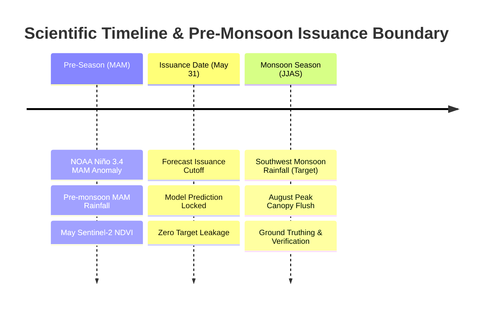
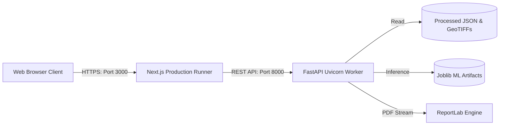

# VARUNA 2047: Technical Design Document

**System Name:** VARUNA 2047 (Viksit Bharat Agricultural Resilience Using National Earth Observation)  
**Target Event:** Hack for Social Cause — VBYLD 2027  
**Architecture Classification:** Decoupled Full-Stack Geospatial AI Platform  

---

## 1. High-Level System Architecture

VARUNA 2047 ingests global climate teleconnections and satellite Earth observations, performs leak-free feature engineering, executes calibrated machine-learning inference, and delivers interactive geospatial intelligence to district agricultural stakeholders.

```mermaid
graph TD
    subgraph Data Providers
        A1[NOAA CPC ONI SST] --> S1[ingest_enso.py]
        A2[NASA POWER Precipitation] --> S2[ingest_rainfall.py]
        A3[ISRO Bhuvan WMS] --> S3[discover_isro.py]
        A4[Sentinel-2 / MODIS NDVI] --> S4[process_vegetation.py]
    end

    subgraph Data Processing & Geospatial Engine
        S1 --> P1[(enso_history.json)]
        S2 --> P2[(rainfall_history.json)]
        S3 --> P3[(isro_provenance.json)]
        S4 --> P4[(vegetation_history.json)]
        S4 --> P5[(GeoTIFF Rasters)]

        P1 & P2 & P4 --> FE[build_features.py]
        FE --> MFD[(model_features_dataset.csv)]
    end

    subgraph Machine Learning Engine
        MFD --> TR[train_models.py]
        TR --> M1[Climatology Baseline]
        TR --> M2[ENSO-Only LR: ROC 0.7830]
        TR --> M3[Climate LR]
        TR --> M4[VARUNA Multimodal XGBoost]
        TR --> EV[evaluate_models.py]
        TR --> SH[shap_summary.json]
    end

    subgraph Backend API (FastAPI)
        M2 & M4 & P1 & P2 & P4 --> API[FastAPI Application]
        API --> EP1[/api/districts]
        API --> EP2[/api/enso]
        API --> EP3[/api/risk/predict]
        API --> EP4[/api/resilience/prioritize]
        API --> EP5[/api/reports/generate]
    end

    subgraph Frontend Application (Next.js 16 App Router)
        API --> UI1[Mission Control]
        API --> UI2[EO Explorer: MapLibre]
        API --> UI3[ENSO Observatory]
        API --> UI4[AI Risk Laboratory]
        API --> UI5[Agricultural Stress Explorer]
        API --> UI6[Resilience Planner]
        API --> UI7[Evidence Reports PDF]
        API --> UI8[Research & Provenance]
    end
```

---

## 2. Component Responsibilities

| Subsystem | Technologies | Core Responsibility |
|---|---|---|
| **Data Ingestion** | Python 3.12, HTTPX, Pandas | Automated retrieval, caching, and parsing of authentic NOAA ONI indices, NASA POWER rainfall, and ISRO WMS services. |
| **Geospatial Engine** | Rasterio, Shapely, PyProj, GeoPandas | Raster math, CRS transformations (EPSG:4326 to 3857), NDVI surface generation, polygon masking, and zonal statistics. |
| **Machine Learning** | Scikit-learn, XGBoost, SHAP, Joblib | Strict chronological training (1982–2014) and out-of-sample evaluation (2015–2024). Leakage-free StandardScaler and SHAP importance. |
| **Decision Support** | ReportLab, Multi-Criteria Scoring | Transparent priority ranking combining deficit risk, vegetation stress, acreage exposure, and irrigation vulnerability. |
| **Backend Service** | FastAPI, Pydantic V2, Uvicorn | 18 OpenAPI-documented REST endpoints, structured validation, CORS, error handling, and PDF binary streaming. |
| **Web Frontend** | Next.js 16 (App Router), TypeScript, Tailwind CSS, MapLibre, Recharts | 8 dedicated research-grade pages with responsive data visualization and zero placeholder mockups. |

---

## 3. Pre-Monsoon Scientific Timing & Leakage Prevention

A fundamental integrity requirement of VARUNA 2047 is strict chronological separation:



- **Feature Predictors ($X$):** Must be observable on or before **May 31**.
- **Prediction Target ($y$):** Binary indicator whether June–September (JJAS) Southwest Monsoon rainfall falls below $80\%$ of the 1981–2010 district climatological normal.
- **Leakage Safeguards:** Scalers and imputers are strictly fitted on the 1982–2014 training partition and never touch validation or test years.

---

## 4. Multi-Criteria Resilience Prioritization Model

To convert probabilistic risk into actionable resource allocation without making unfounded crop prescriptions, VARUNA 2047 uses transparent Multi-Criteria Decision Analysis (MCDA):

$$\text{Composite Score} = w_{\text{risk}} \cdot S_{\text{risk}} + w_{\text{veg}} \cdot S_{\text{veg}} + w_{\text{exp}} \cdot S_{\text{exp}} + w_{\text{irr}} \cdot S_{\text{irr}}$$

Where:
- $S_{\text{risk}} = P(\text{Deficit}) \times 100$ (from validated ML inference)
- $S_{\text{veg}} = 100 - \text{VCI}$ (vegetation canopy stress from Sentinel-2)
- $S_{\text{exp}} = \frac{\text{Net Sown Area}}{\max(\text{Net Sown Area})} \times 100$ (exposure in hectares)
- $S_{\text{irr}} = 100 - \text{Irrigation Coverage } \%$ (rainfed vulnerability)
- Normalized weights: $\sum w_i = 1.0$ (adjustable dynamically in UI).

---

## 5. Deployment Architecture


