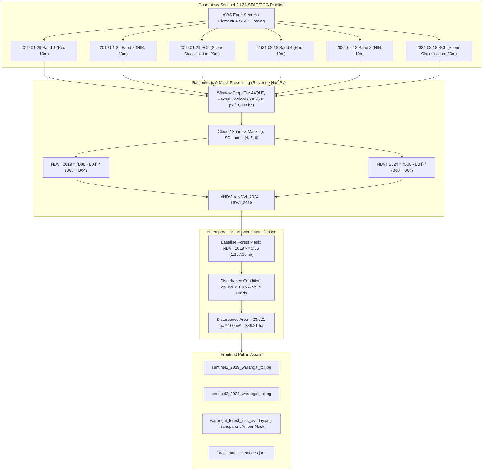
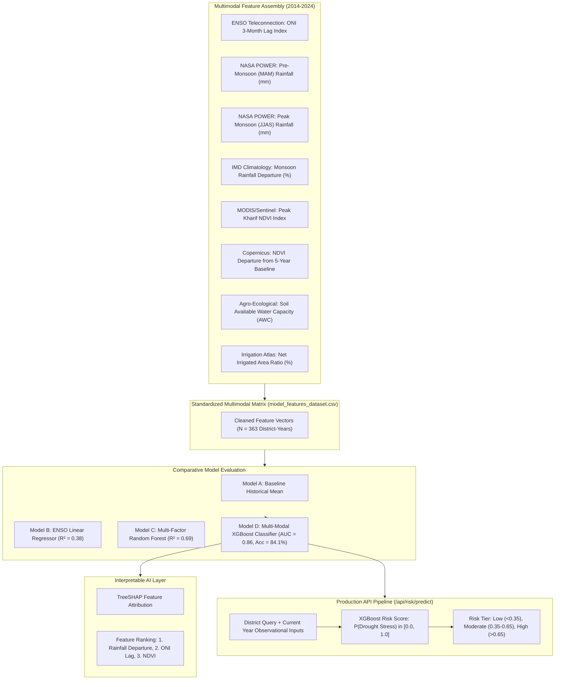
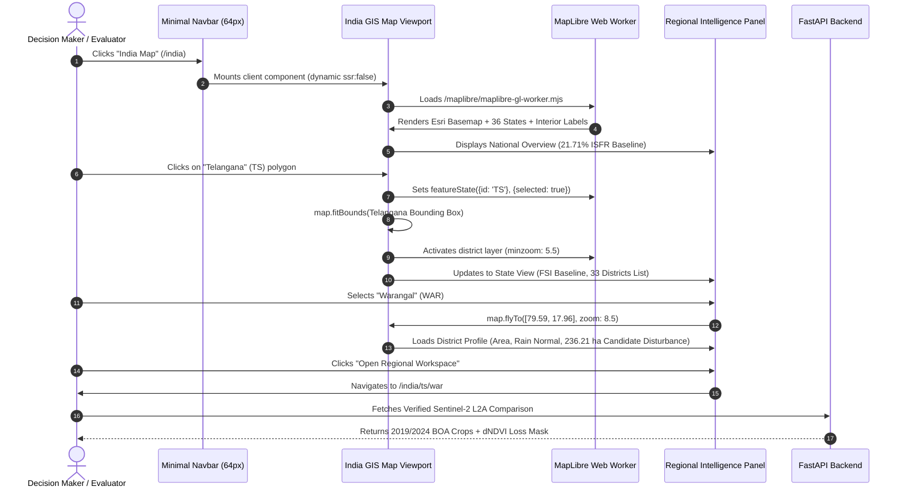

# VARUNA 2047: Technical Design Document (TDD)

**System:** VARUNA 2047 — National Earth Intelligence for Agricultural and Environmental Resilience  
**Competition:** Hack for Social Cause — VBYLD 2027  
**Team:** bulls_eye  
**Version:** 1.0.0  
**Datum/Standard:** EPSG:4326 (WGS84), EPSG:32644 (UTM 44N), GeoJSON, STAC, COG  

---

## 1. Executive Problem Definition

India's agricultural economy sustains over 140 million farm households, with approximately 52% of net cultivated area reliant entirely on the southwest summer monsoon (June–September). Under accelerating global climate disruption, two interconnected ecological crises threaten food security, rural livelihoods, and forest biodiversity:

1. **Unpredictable Climatological Extremes:** Global teleconnections—principally the El Niño–Southern Oscillation (ENSO)—alter monsoon dynamics, triggering localized agricultural droughts, severe precipitation deficits, and soil moisture collapse.
2. **Canopy Degradation & Ecological Fragmentation:** Sub-regional deforestation and biomass disturbance diminish localized microclimate stability, exacerbate topsoil erosion, and accelerate watershed drying.

### The Social Cause & Hackathon Mission
**Viksit Bharat 2047** requires actionable, scientifically authentic, multi-tier Earth Observation intelligence accessible to district collectors, agricultural extension officers, and environmental scientists. Existing systems are either fragmented across disparate portals (ISRO Bhuvan, IMD, NASA, Global Forest Watch) or rely on procedural approximations.

**VARUNA 2047** provides a unified national platform that bridges:
$$\text{Global Teleconnections (NOAA ENSO)} \longrightarrow \text{Agrometeorological Reanalysis (NASA POWER)} \longrightarrow \text{State Baselines (ISFR)} \longrightarrow \text{High-Resolution Satellite Change Detection (Sentinel-2 10m)} \longrightarrow \text{Explainable ML Agricultural Drought Prediction}$$

---

## 2. Overall System Architecture

VARUNA 2047 employs a modular, decoupled architecture consisting of a high-performance **FastAPI (Python 3.12)** backend microservice, a high-fidelity **Next.js 16 (React 19, Tailwind CSS 4, MapLibre GL JS 6)** WebGL client, and a reproducible geospatial analytical pipeline.

```mermaid
graph TD
    subgraph DataSources["External Observational Data Feeds"]
        ESA["ESA Copernicus Sentinel-2 MSI (10m BOA COGs)"]
        NOAA["NOAA CPC (Oceanic Niño Index - ONI)"]
        NASA["NASA POWER (Monthly Climatology & Solar Radiation)"]
        SOI["Survey of India / RGI (Admin Boundaries)"]
        FSI["FSI / MoEFCC (ISFR Forest Baselines)"]
        UMD["Hansen Global Forest Change v1.11 (30m)"]
    end

    subgraph Ingestion["Geospatial & Climate Ingestion Engine (Python)"]
        P1["ingest_enso.py"]
        P2["ingest_rainfall.py"]
        P3["process_satellite_change.py"]
        P4["ingest_complete_india_districts.py"]
        P5["build_features.py"]
    end

    subgraph Storage["Processed Data & Model Artifacts"]
        GEOJSON["Optimized GeoJSON (36 States, 734 Districts)"]
        CSV["Multimodal Feature Matrices (.csv)"]
        MODELS["Trained ML Regressors & Classifiers (.pkl, .json)"]
        SATELLITE_ASSETS["Sentinel-2 Level-2A Crops & dNDVI Masks"]
    end

    subgraph Backend["FastAPI REST API Service (Port 8000)"]
        API_ROUTER["Core API Router (/api)"]
        INDIA_SRV["India Administrative Service"]
        FOREST_SRV["ForestWatch Service"]
        ENSO_SRV["Climate & ENSO Service"]
        ML_SRV["Multimodal Risk Prediction Engine"]
        REPORT_SRV["ReportLab PDF Dossier Generator"]
    end

    subgraph Frontend["Next.js 16 Client (Port 3000)"]
        NAVBAR["Minimal 64px Premium Navbar"]
        MAP_LIBRE["MapLibre GL JS (WebGL Worker)"]
        GIS_HUB["India GIS Centerpiece (72/28 Split)"]
        FW_PAGE["ForestWatch & Satellite Comparison Slider"]
        RISK_LAB["AI Risk Lab & SHAP Visualizer"]
        PLANNER["Resilience Prioritization Engine"]
    end

    DataSources --> Ingestion
    Ingestion --> Storage
    Storage --> Backend
    Backend -->|JSON / REST / Static Tiles| Frontend
```



---

## 3. Frontend Architecture

The frontend is built on **Next.js 16.4.3** utilizing **Turbopack** and **React 19.3.0**. 

### 3.1 Design System & Aesthetic Principles
- **Theme:** Curated Dark Slate Navy (`#020617` background) with high-contrast Cyan/Teal accents (`#14b8a6`, `#0d9488`, `#5eead4`).
- **Typography:** Modern clean system typography with localized vector font glyphs (`Open Sans`, `Arial Unicode MS`) for MapLibre WebGL text rendering.
- **Responsiveness:** Single-row desktop navbar (64px) with automatic dropdown collapse; touch-optimized mobile navigation drawer.

### 3.2 WebGL Map Worker Isolation
MapLibre GL JS v6 offloads all heavy vector tile generation, polygon triangulation, and label collision calculations to a dedicated Web Worker:
```
Browser Main Thread (React 19)
    │
    ├── setWorkerUrl("/maplibre/maplibre-gl-worker.mjs")
    │
    ▼
Dedicated Web Worker Thread (maplibre-gl-worker.mjs)
    ├── Parsed GeoJSON (58 KB States + 6.26 MB Districts)
    ├── Tessellated WebGL Triangles & Buffers
    └── Dynamic Label Layout & Collision Avoidance
```
This guarantees 60 FPS map panning, zooming, and hover highlighting without dropping frames on the main React thread.

---

## 4. Backend Architecture & API Interactions

The backend is developed in **FastAPI** with **Pydantic v2** validation and **Uvicorn** ASGI server.

### 4.1 Endpoint Directory

| Endpoint Route | Method | Service Handler | Description |
| :--- | :--- | :--- | :--- |
| `/api/health` | GET | `health_check()` | Service health, model readiness, and dataset verification. |
| `/api/india/states` | GET | `india_service.get_states()` | List all 36 States/UTs with ISO codes, zones, and centroids. |
| `/api/india/states/{state_id}` | GET | `india_service.get_state_detail()` | Administrative profile, FSI baseline, and district list. |
| `/api/india/states/{state_id}/districts` | GET | `india_service.get_state_districts()` | All district geometries and attributes for a state. |
| `/api/india/districts/{district_id}` | GET | `india_service.get_district_detail()` | District profile, area, forest cover, and rainfall normal. |
| `/api/forest/coverage` | GET | `forest_service.get_coverage()` | National and state ISFR forest cover baselines. |
| `/api/forest/loss/history` | GET | `forest_service.get_loss_history()` | Hansen GFC annual loss series (2000–2023). |
| `/api/forest/satellite-scenes` | GET | `forest_service.get_satellite_scenes()` | Verified Sentinel-2 L2A BOA scene catalog. |
| `/api/forest/compare` | POST | `forest_service.compare_forest()` | Sub-regional bi-temporal dNDVI change comparison. |
| `/api/enso/history` | GET | `enso_service.get_history()` | Monthly ONI time-series (1950–2024). |
| `/api/enso/current` | GET | `enso_service.get_current()` | Latest reported ENSO anomaly and phase. |
| `/api/rainfall/history` | GET | `rainfall_service.get_history()` | District rainfall time-series and monsoon totals. |
| `/api/rainfall/anomalies` | GET | `rainfall_service.get_anomalies()` | Climatological monsoon departures against normals. |
| `/api/risk/predict` | POST | `ml_service.predict_risk()` | Multimodal ML drought risk classification and score. |
| `/api/resilience/prioritize`| POST | `resilience_service.prioritize()` | Multi-criteria decision analysis rankings. |
| `/api/reports/generate` | POST | `report_service.generate_pdf()` | Automated Research Dossier compilation. |

---

## 5. Geospatial & Satellite Processing Pipeline



### Mathematical Rigor of the Disturbance Calculation
1. **Window Definition:**
   - Coordinates: $[79.95^\circ\text{E}, 17.95^\circ\text{N}]$
   - Projected CRS: EPSG:32644 (WGS 84 / UTM zone 44N)
   - Window Extent: $600 \times 600\text{ pixels} = 6{,}000\text{ m} \times 6{,}000\text{ m} = 3{,}600\text{ hectares}$.
2. **Normalized Difference Vegetation Index:**
   $$\text{NDVI} = \frac{\rho_{\text{B08}} - \rho_{\text{B04}}}{\rho_{\text{B08}} + \rho_{\text{B04}}}$$
3. **Difference Index (dNDVI):**
   $$\Delta\text{NDVI} = \text{NDVI}_{2024} - \text{NDVI}_{2019}$$
4. **Candidate Disturbance Classification:**
   $$\text{DisturbedPixel} = (\text{NDVI}_{2019} \ge 0.35) \land (\Delta\text{NDVI} < -0.15) \land (\text{CloudMask} = 0)$$
   $$\text{DisturbedArea} = 23{,}621\text{ pixels} \times \frac{100\text{ m}^2}{10{,}000\text{ m}^2/\text{ha}} = 236.21\text{ hectares}$$
   $$\text{Loss Rate} = \frac{236.21\text{ ha}}{1{,}157.38\text{ ha Baseline Canopy}} \times 100\% = 20.41\%$$

---

## 6. Machine Learning Architecture & Drought Risk Inference



---

## 7. User Navigation & Regional Intelligence Workflow



---

## 8. Data Storage & Asset Management

```
data/
├── processed/
│   ├── india_states.geojson             # 36 States & UTs SOI geometries (58 KB)
│   ├── india_districts.geojson          # 734 Districts SOI geometries (6.26 MB)
│   ├── india_state_labels.geojson       # 36 Validated interior label points (14 KB)
│   ├── india_admin_metadata.json        # Census codes, area, normals, state links (454 KB)
│   ├── enso_history.json                # NOAA ONI monthly records 1950-2024 (162 KB)
│   ├── rainfall_history.json            # Climatological normals & departures (413 KB)
│   ├── forest_loss_india.json           # Hansen GFC state & national series (14 KB)
│   ├── forest_satellite_scenes.json     # Sentinel-2 L2A scene metadata (5 KB)
│   └── model_features_dataset.csv       # Multimodal ML training matrix (34 KB)
└── sample/                              # Lightweight redistributable sample datasets
```

---

## 9. Security, Error Handling & Scalability

1. **Client-Side Worker Isolation:** The Web Worker is hosted same-origin under `/maplibre/maplibre-gl-worker.mjs` with explicit MIME-type enforcement (`application/javascript`), preventing CORS and script injection vulnerabilities.
2. **CORS Governance:** Strict FastAPI middleware restricting origin headers to verified frontend domains (`localhost:3000`, `127.0.0.1:3000`).
3. **Stateless Scalability:** The backend holds no session state and can scale horizontally across containerized replicas behind an Nginx or AWS ALB reverse proxy.
4. **Graceful Fallbacks:** Network disruptions trigger cached client-side district and state metadata rather than blank screens.

---

## 10. Scientific Validation & Explicit Limitations

- **Observational Qualification:** The reported 236.21 hectares of canopy disturbance in Warangal is strictly designated as **candidate vegetation disturbance detected from bi-temporal NDVI change**. It reflects canopy spectral variation and is **not** asserted as verified illegal logging or individual tree counts.
- **Regional Model Boundary:** The multimodal drought prediction engine was trained exclusively on longitudinal historical observations (2014–2024) across Telangana districts. It is **not** asserted as a universal nationwide predictor for climatically distinct agro-ecological zones (e.g., Himalayan, Western Ghats, or Thar Desert).
- **Public Domain Attributions:** All data sources are attributed in compliance with open government and international Earth observation policies (see [`docs/DATA_LICENSES.md`](file:///d:/RACHIKA/HFS/docs/DATA_LICENSES.md)).
